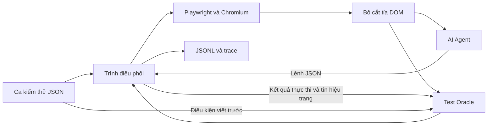

# Đặc tả Giai đoạn 1 của Trần Văn Thịnh

Phiên bản hợp đồng `0.1`. Python chạy Agent, Playwright, bộ cắt tỉa, Oracle và trình điều phối. Chromium chạy ứng dụng được kiểm thử.

## Câu hỏi và phạm vi

Với cùng giới hạn token DOM, lọc theo thao tác và điều kiện kiểm tra có cải thiện khả năng phát hiện lỗi so với lọc theo thao tác không? Nhóm chạy kiểm thử hộp đen và dùng dữ liệu người dùng có thể quan sát để đối chiếu ONR, NLE và Crash.

## Sơ đồ mô-đun



| Mô-đun | Đầu vào | Đầu ra |
|---|---|---|
| Runner | Ca JSON, chế độ DOM, cấu hình chạy | Kết luận, JSONL, trace và số liệu |
| Playwright | Lệnh đã kiểm tra, trạng thái trình duyệt | Snapshot DOM trước và sau, URL, trạng thái thực thi, sự kiện crash |
| Bộ cắt tỉa | Snapshot, thao tác, giới hạn token, điều kiện ở chế độ đề xuất | DOM rút gọn, mã snapshot, mã nút được giữ và số token |
| Agent | Mô tả bước, điều kiện viết trước và DOM được cấp | Một lệnh JSON cho mỗi bước |
| Oracle | Điều kiện, DOM theo chế độ, kết quả thao tác và tín hiệu trang chung | Kết luận, lý do và tham chiếu bằng chứng |

## Cách thực hiện

1. Viết ca theo [lược đồ ca kiểm thử](../contracts/test-case.schema.json). Mỗi ca có mục tiêu, đường dẫn ban đầu, mã dữ liệu khởi tạo và các bước. Mỗi bước xác định đối tượng, thao tác, điều kiện kỳ vọng và thời gian chờ. Chốt điều kiện trước khi chạy.
2. Runner đặt lại fixture và lấy snapshot trước. Huy cung cấp mỗi nút kèm mã, vai trò, tên, vùng chứa và giá trị quan sát được nếu có. Mỗi snapshot có `observation_id` riêng. Bộ cắt tỉa dùng chung định dạng tuần tự hóa và bộ đếm token giữa các cấu hình.
3. Agent xuất [lệnh JSON](../contracts/agent-action.schema.json). Ví dụ dưới đây bấm nút có mã `n-21` trong snapshot `obs-1`. Runner kiểm tra phiên bản, snapshot hiện tại, mã nút còn hợp lệ và thao tác có trong danh sách hỗ trợ. Nếu định vị bị mơ hồ, ghi lỗi thao tác và lấy trạng thái mới trước khi cân nhắc thử lại.
4. Playwright thực thi, ghi URL và sự kiện từ lúc bắt đầu thao tác. Runner dùng cùng cửa sổ chờ cho mọi cấu hình, rồi lấy snapshot sau. `settle_ms` là khoảng ổn định tối thiểu nằm trong `timeout_ms`, tính theo tín hiệu phù hợp từng ca. Bộ đếm thời hạn tiếp tục chạy qua các lần chuyển hướng.
5. Oracle so sánh theo tên đối tượng và trường nghiệp vụ qua hai snapshot. Mã nút chỉ dùng trong snapshot của nó. DOM đầy đủ và trace phục vụ hậu kiểm. Nhãn chuẩn chỉ dùng lúc tính chỉ số.
6. Runner ghi kết luận lần đầu trước khi áp dụng bất kỳ cơ chế phục hồi nào. Ghi tối thiểu mã lượt chạy, ca và bước, chế độ, lệnh, URL theo thời gian, bằng chứng, kết luận, lý do, token và thời gian. Khi so sánh, dùng cùng phiên bản mô hình, prompt, trình duyệt, chính sách chờ và thử lại.

```json
{"schema_version":"0.1","observation_id":"obs-1","action":"click","target_id":"n-21"}
```

Runner kiểm thêm `settle_ms <= timeout_ms` và mã bước không trùng trong ca. Thiếu nút hoặc mã snapshot cũ là lỗi thực thi Agent. Chỉ thử lại thao tác thay đổi dữ liệu khi đã xác minh lần trước chưa thực thi hoặc đã đặt lại trạng thái, để tránh thêm hàng hai lần.

## Quy tắc tích hợp với Oracle

| Kết luận | Tiêu chí |
|---|---|
| PASS | Đã thực thi đúng thao tác và đủ bằng chứng thỏa điều kiện. |
| ONR | Thao tác đúng, vùng kết quả có thể quan sát và hiệu ứng bắt buộc vẫn vắng mặt sau thời hạn. |
| NLE | Thao tác đúng, điểm đến đã ổn định và sai theo điều kiện ca. |
| CRASH | Có sự kiện crash liên quan đến ca, hoặc có dấu hiệu lỗi nghiêm trọng đã định nghĩa làm gián đoạn chức năng. Ghi riêng nguồn tín hiệu. |
| INCONCLUSIVE | Thiếu bằng chứng, hoặc hết Navigation Wait khi URL còn thay đổi và chưa có tín hiệu crash xác định. |
| AGENT_ERROR / INFRA_ERROR | Sai đích, lệnh không hợp lệ hoặc sự cố môi trường. Ghi nguyên nhân và dấu vết. |

Với ca giỏ hàng, thấy số lượng 1 trước và sau trong đúng dòng sản phẩm A là bằng chứng để xét ONR. Nếu bộ lọc bỏ mất dòng giỏ hàng, trả `INCONCLUSIVE`. Nếu có lỗi thật mà hệ thống không phát hiện, lượt đó tính là bỏ sót trong recall đầu-cuối.

## Đầu ra và nghiệm thu

| Đầu ra | Tệp hoặc thư mục | Kiểm tra |
|---|---|---|
| Sơ đồ và quy tắc tích hợp | Tài liệu này | Agent, Playwright, bộ lọc, Oracle và runner thống nhất đầu vào và đầu ra. |
| Định dạng lệnh và ca | [contracts](../contracts/) | Lệnh đúng qua kiểm tra, lệnh nhập thiếu giá trị bị từ chối. |
| Ba ca minh họa | [cases](../datasets/cases/) và [labels](../datasets/labels/) | Mỗi ca có bản đúng và một biến thể dự kiến, bao phủ ONR, NLE và Crash. |
| Kiểm tra hợp đồng | [tests](../tests/) | Lệnh trong README chạy qua toàn bộ ca mẫu. |

Các ca mẫu là dữ liệu đặc tả để bàn giao. Chạy kiểm thử trên web demo cần fixture, bộ điều khiển và các mô-đun thực thi ở giai đoạn sau.
